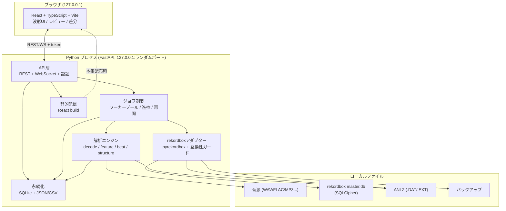
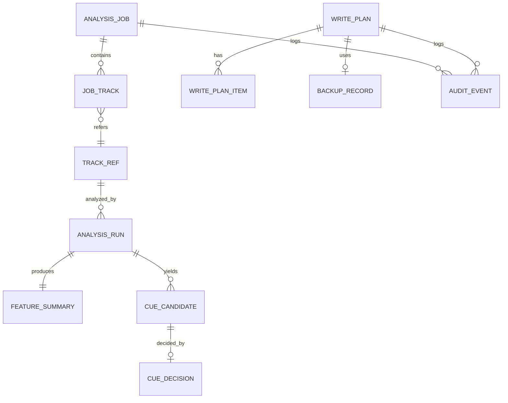
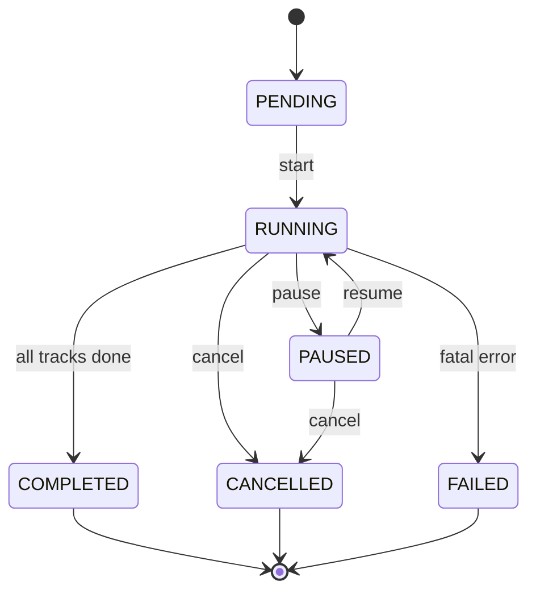
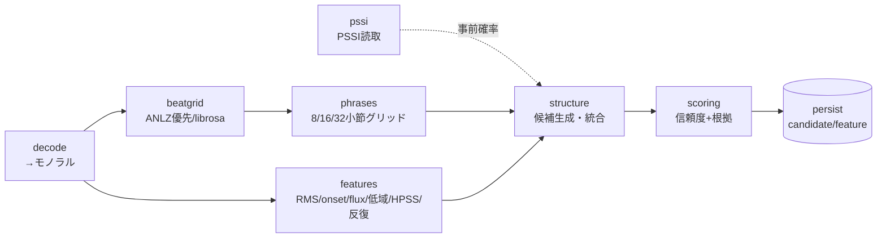
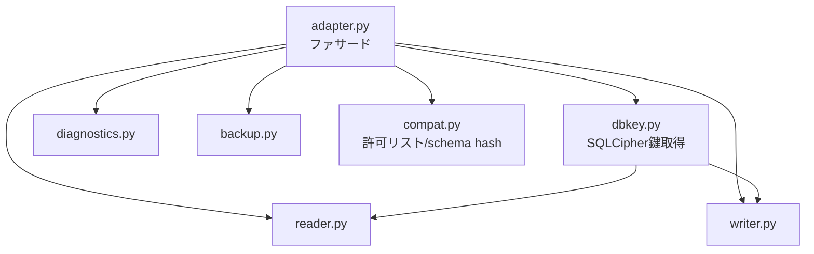
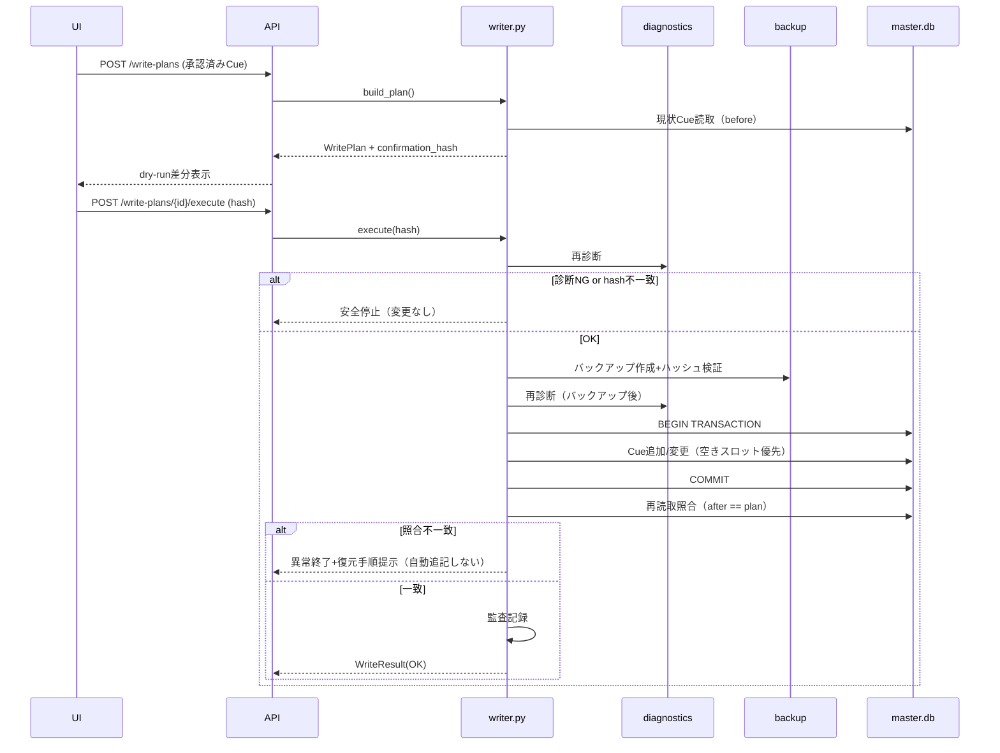

# rekordbox AI Cue Generator 基本設計書

*SOFTWARE DESIGN DOCUMENT*

**対象要件:** rekordbox AI Cue Generator 要件定義書 v1.1
**版:** Version 0.2（レビュー済・P0範囲確定）
**作成日:** 2026年8月6日
**状態:** 確定（P0互換性スパイク着手可）

> **本書の位置づけ**
> 要件定義書 v1.1 を実装可能な粒度へ落とし込む。アーキテクチャ、モジュール責務、データモデル、API/WebSocket契約、解析パイプライン、書き込みトランザクション、エラー体系、P0スパイクの設計を定義する。UI詳細（画面遷移・コンポーネント）とML拡張は本書の対象外とし、別紙で扱う。

---

## 1. 設計方針

| 方針 | 内容 | 由来する要件 |
|------|------|--------------|
| 層の分離 | UI / API / ジョブ / 解析 / rekordboxアダプター / 永続化 を独立モジュール化し、各層を単体試験可能にする。 | NFR-010 |
| ローカル完結 | 音源・DB・解析結果を外部送信しない。127.0.0.1限定・起動トークン・Origin制限。 | NFR-009, §11.3 |
| 安全第一の書き込み | 診断→バックアップ→再診断→トランザクション→照合→監査。confirmation_hash で計画同一性を保証。 | §11.2, FR-WRT-* |
| 説明可能な候補 | しきい値単発ではなく複数特徴量＋フレーズ整合＋PSSI事前確率を合成し、信頼度と根拠を返す。 | §7, FR-ANL-006 |
| 冪等・再現性 | 音源指紋＋エンジン版＋パラメータで解析をキャッシュ。同一入力で同一候補。 | NFR-006, FR-ANL-008 |
| 失敗の隔離 | 1曲の失敗がバッチ全体を止めない。ワーカー単位で例外を封じ込める。 | NFR-004, FR-ANL-009 |
| 依存の隔離 | pyrekordbox は adapter 層に閉じ込め、上位はドメイン型のみ扱う。版変化の影響を局所化。 | §18 |

### 設計上の非目標（Non-Goals）
- ANLZ の新規生成・改変（MVPは読み取り専用）。
- USBエクスポートライブラリへの直接操作。
- 教師ありMLによる自動構造認識（評価データ蓄積後の拡張）。

---

## 2. システムアーキテクチャ

### 2.1 全体構成



### 2.2 プロセス・ポート・認証
- バックエンドは起動時に **127.0.0.1 のランダム空きポート** へバインドする。
- 起動時に暗号論的乱数で **一時トークン**（32バイト以上）を生成。REST は `Authorization: Bearer <token>`、WebSocket は接続クエリまたはサブプロトコルで検証する。
- CORS/Origin は起動中に払い出したローカル画面のOriginのみ許可。
- 本番配布では React build を FastAPI が静的配信（同一Origin化）。開発時は Vite dev server（5173）から API へCORS許可。

### 2.3 デプロイ形態
| 環境 | フロント | バックエンド | 備考 |
|------|----------|--------------|------|
| 開発 | Vite dev (5173) | uvicorn --reload | CORSで疎通、HMR有効 |
| 本番 | 静的build同梱 | PyInstaller等で単一起動 | 起動でブラウザを自動オープン |

---

## 3. ディレクトリ構成

```text
AICueGenerator/
├─ docs/                         # 設計・要件
├─ backend/
│  ├─ app/
│  │  ├─ main.py                 # FastAPI起動・トークン発行・静的配信
│  │  ├─ config.py               # 設定ロード（pydantic-settings）
│  │  ├─ security.py             # トークン/Origin/パス検証
│  │  ├─ api/
│  │  │  ├─ deps.py              # 認証・DIの依存
│  │  │  ├─ routes_health.py
│  │  │  ├─ routes_playlists.py
│  │  │  ├─ routes_jobs.py
│  │  │  ├─ routes_tracks.py
│  │  │  ├─ routes_candidates.py
│  │  │  ├─ routes_write.py
│  │  │  ├─ routes_backups.py
│  │  │  ├─ routes_reports.py
│  │  │  └─ ws.py                # WebSocketイベント配信
│  │  ├─ schemas/                # Pydantic Request/Response
│  │  ├─ domain/                 # ドメイン型（pyrekordbox非依存）
│  │  │  ├─ models.py            # TrackRef, CueCandidate, WritePlan...
│  │  │  ├─ enums.py             # CueType, JobStatus, ErrorCode...
│  │  │  └─ events.py            # WSイベント定義
│  │  ├─ jobs/
│  │  │  ├─ manager.py           # ジョブ登録・状態機械・キャンセル
│  │  │  ├─ worker.py            # プロセス/スレッドプール実行
│  │  │  └─ progress.py          # 連番付きイベント発行
│  │  ├─ analysis/
│  │  │  ├─ decode.py            # 音源デコード→モノラル
│  │  │  ├─ beatgrid.py          # ANLZ PQTZ読取 / librosa推定
│  │  │  ├─ features.py          # RMS/onset/flux/低域/HPSS/反復
│  │  │  ├─ phrases.py           # 8/16/32小節フレーズグリッド
│  │  │  ├─ pssi.py              # ANLZ PSSI読取（XORマスク解除）
│  │  │  ├─ structure.py         # 候補生成・統合・Top-3
│  │  │  ├─ scoring.py           # 信頼度算出・根拠
│  │  │  └─ fingerprint.py       # 音源指紋
│  │  ├─ rekordbox/
│  │  │  ├─ adapter.py           # 上位向けファサード
│  │  │  ├─ dbkey.py             # SQLCipher鍵取得
│  │  │  ├─ diagnostics.py       # プロセス/版/スキーマ/容量診断
│  │  │  ├─ reader.py            # プレイリスト/曲/既存Cue読取
│  │  │  ├─ writer.py            # 書込計画→トランザクション→照合
│  │  │  ├─ backup.py            # バックアップ/復元
│  │  │  └─ compat.py            # 許可リスト/schema hash
│  │  ├─ persistence/
│  │  │  ├─ db.py                # アプリSQLite接続（WALモード）
│  │  │  ├─ migrations/          # スキーマDDL/マイグレーション
│  │  │  └─ repositories.py      # CRUD
│  │  └─ reporting/
│  │     └─ export.py            # CSV/JSON出力
│  ├─ tests/                     # 単体/API/統合/障害注入/精度
│  ├─ pyproject.toml
│  └─ requirements.lock          # 依存固定
├─ frontend/
│  ├─ src/
│  │  ├─ api/                    # 型付きAPIクライアント（OpenAPI生成）
│  │  ├─ features/
│  │  │  ├─ home/                # 診断
│  │  │  ├─ playlists/
│  │  │  ├─ jobs/
│  │  │  ├─ review/             # 波形・試聴・編集
│  │  │  ├─ write/              # 差分・実行
│  │  │  └─ history/
│  │  ├─ components/
│  │  ├─ store/                  # 状態管理
│  │  └─ ws/                     # WebSocketクライアント（再接続）
│  ├─ package.json
│  └─ vite.config.ts
└─ scripts/                      # 起動/ビルド/パッケージング
```

---

## 4. データモデル（アプリSQLite）

要件 §10 を実装スキーマへ具体化する。SQLite は **WAL モード**、外部キー有効、時刻は UTC ISO8601 文字列で保持する。音源本体は保存しない。

### 4.1 ER 図



### 4.2 主要テーブル DDL（抜粋・SQLite方言）

```sql
-- rekordbox曲参照（音源複製なし）
CREATE TABLE track_ref (
    id            TEXT PRIMARY KEY,             -- アプリ内UUID
    content_id    TEXT NOT NULL,                -- rekordbox DjmdContent.ID
    rb_uuid       TEXT,                         -- rekordbox UUID（あれば）
    path          TEXT NOT NULL,
    format        TEXT NOT NULL,                -- WAV/AIFF/FLAC/MP3_CBR/MP3_VBR/AAC...
    duration_ms   INTEGER,
    sample_rate   INTEGER,
    metadata_json TEXT,                         -- title/artist/bpm/key/genre 等
    writable      INTEGER NOT NULL DEFAULT 0,   -- 0/1: 書込可否（VBR等で0）
    skip_reason   TEXT,                         -- 除外理由（NULL可）
    created_at    TEXT NOT NULL,
    UNIQUE(content_id)
);

-- 解析実行（再現性・キャッシュ判定）
CREATE TABLE analysis_run (
    id                TEXT PRIMARY KEY,
    track_id          TEXT NOT NULL REFERENCES track_ref(id) ON DELETE CASCADE,
    engine_version    TEXT NOT NULL,
    params_json       TEXT NOT NULL,            -- 解析パラメータ（しきい値/並列等）
    audio_fingerprint TEXT NOT NULL,            -- 音源指紋
    beat_source       TEXT NOT NULL,            -- ANLZ / LIBROSA
    pssi_used         INTEGER NOT NULL DEFAULT 0,
    status            TEXT NOT NULL,            -- PENDING/RUNNING/DONE/FAILED/SKIPPED
    error_id          TEXT,
    started_at        TEXT,
    finished_at       TEXT,
    UNIQUE(track_id, engine_version, audio_fingerprint, params_json)
);

-- 特徴量要約（画面表示・構造推定）
CREATE TABLE feature_summary (
    run_id       TEXT PRIMARY KEY REFERENCES analysis_run(id) ON DELETE CASCADE,
    bpm          REAL,
    beat_times_json TEXT,                       -- 拍時刻（ms）配列（要約 or 参照）
    downbeats_json  TEXT,                       -- ダウンビート時刻
    bars_json       TEXT,                       -- 小節境界
    energy_json     TEXT,                       -- 小節集約されたRMS/低域/onset等
    waveform_peaks_json TEXT                    -- 波形描画用ピーク（間引き）
);

-- AI候補
CREATE TABLE cue_candidate (
    id           TEXT PRIMARY KEY,
    run_id       TEXT NOT NULL REFERENCES analysis_run(id) ON DELETE CASCADE,
    type         TEXT NOT NULL,                 -- INTRO_END/BREAK/BUILD/DROP/OUTRO
    time_ms      INTEGER NOT NULL,
    beat         INTEGER,
    bar          INTEGER,
    confidence   INTEGER NOT NULL,              -- 0..100
    rank         INTEGER NOT NULL,              -- 種類内順位（1がTop）
    evidence_json TEXT NOT NULL,                -- 根拠（特徴量差分/PSSI整合など）
    created_at   TEXT NOT NULL
);

-- 利用者の判断
CREATE TABLE cue_decision (
    id           TEXT PRIMARY KEY,
    candidate_id TEXT NOT NULL REFERENCES cue_candidate(id) ON DELETE CASCADE,
    accepted     INTEGER NOT NULL DEFAULT 0,
    edited_time_ms INTEGER,                     -- 手動調整後の時刻（NULLで候補値）
    cue_kind     TEXT NOT NULL,                 -- MEMORY / HOT
    slot         TEXT,                          -- HOTのA/B/C/D等
    color        TEXT,
    comment      TEXT,
    updated_at   TEXT NOT NULL,
    UNIQUE(candidate_id)
);

-- 書込計画（dry-run差分と実行同一性）
CREATE TABLE write_plan (
    id                TEXT PRIMARY KEY,
    job_id            TEXT,
    confirmation_hash TEXT NOT NULL,            -- 計画内容のハッシュ
    status            TEXT NOT NULL,            -- DRAFT/CONFIRMED/EXECUTED/FAILED/ROLLED_BACK
    backup_id         TEXT REFERENCES backup_record(id),
    created_at        TEXT NOT NULL,
    executed_at       TEXT
);

CREATE TABLE write_plan_item (
    id           TEXT PRIMARY KEY,
    plan_id      TEXT NOT NULL REFERENCES write_plan(id) ON DELETE CASCADE,
    track_id     TEXT NOT NULL REFERENCES track_ref(id),
    action       TEXT NOT NULL,                 -- ADD/KEEP/REPLACE/SKIP/CONFLICT
    cue_kind     TEXT NOT NULL,
    slot         TEXT,
    before_json  TEXT,                          -- 変更前Cue
    after_json   TEXT,                          -- 変更後Cue
    reason       TEXT
);

-- バックアップ証跡
CREATE TABLE backup_record (
    id            TEXT PRIMARY KEY,
    path          TEXT NOT NULL,
    created_at    TEXT NOT NULL,
    size_bytes    INTEGER NOT NULL,
    hash          TEXT NOT NULL,
    db_version    TEXT,
    restore_status TEXT                         -- NONE/RESTORED/VERIFIED
);

-- 監査ログ（変更追跡・障害調査）
CREATE TABLE audit_event (
    id          TEXT PRIMARY KEY,
    actor       TEXT NOT NULL,                  -- ローカル利用者識別
    action      TEXT NOT NULL,
    target      TEXT,
    before_json TEXT,
    after_json  TEXT,
    result      TEXT NOT NULL,                  -- OK/ERROR
    error_id    TEXT,
    job_id      TEXT,
    track_id    TEXT,
    created_at  TEXT NOT NULL
);
```

### 4.3 キャッシュ判定
`analysis_run` の `UNIQUE(track_id, engine_version, audio_fingerprint, params_json)` を用い、同一なら再解析せず既存 `run_id` を再利用する（NFR-006, FR-ANL-008）。保存期間は解析キャッシュ180日、監査1年、バックアップ直近5世代（§10.2）を定期ジョブで適用。

---

## 5. ドメイン型（pyrekordbox非依存）

上位層は pyrekordbox の型を直接扱わず、以下のドメイン型のみを用いる。adapter 層が相互変換する。

```python
# domain/enums.py
class CueType(str, Enum):
    INTRO_END = "INTRO_END"
    BREAK = "BREAK"
    BUILD = "BUILD"
    DROP = "DROP"
    OUTRO = "OUTRO"

class CueKind(str, Enum):
    MEMORY = "MEMORY"
    HOT = "HOT"

class JobStatus(str, Enum):
    PENDING = "PENDING"; RUNNING = "RUNNING"; PAUSED = "PAUSED"
    COMPLETED = "COMPLETED"; CANCELLED = "CANCELLED"; FAILED = "FAILED"

class BeatSource(str, Enum):
    ANLZ = "ANLZ"; LIBROSA = "LIBROSA"

class WriteAction(str, Enum):
    ADD = "ADD"; KEEP = "KEEP"; REPLACE = "REPLACE"; SKIP = "SKIP"; CONFLICT = "CONFLICT"
```

---

## 6. API設計

### 6.1 共通規約
- ベースURL `/api/v1`。全 Request/Response は Pydantic で検証。
- 認証: `Authorization: Bearer <起動トークン>`。未認証は `401`。
- 長時間処理は `job_id` を返す非同期方式。ポーリング（REST）とプッシュ（WS）を併用。
- 書き込み系は二段階：`POST /write-plans`（計画）→ `POST /write-plans/{id}/execute`（`confirmation_hash` 添付で実行）。
- 音源/DBパスは画面から受け取らず、検証済みID（track_id等）から backend が解決（パストラバーサル拒否）。

### 6.2 統一エラー応答

```json
{
  "error": {
    "code": "RBX_RUNNING",
    "message": "rekordboxが起動中です。終了してから再診断してください。",
    "retriable": true,
    "detail_id": "err_01J...",
    "context": { "process": "rekordbox.exe" }
  }
}
```

### 6.3 エンドポイント詳細（主要）

| Method | Path | 概要 | 主な成功応答 |
|--------|------|------|--------------|
| GET | `/api/v1/health` | アプリ状態・対応版・rekordbox診断・DB鍵可否 | `HealthResponse` |
| GET | `/api/v1/playlists` | プレイリスト階層 | `PlaylistTree` |
| GET | `/api/v1/playlists/{id}/tracks` | 曲一覧・形式・既存Cue・対象可否 | `TrackList` |
| POST | `/api/v1/analysis-jobs` | 解析ジョブ作成（track_id配列＋params） | `202 {job_id}` |
| GET | `/api/v1/analysis-jobs/{id}` | 進捗・結果概要 | `JobStatusResponse` |
| WS | `/api/v1/analysis-jobs/{id}/events` | 進捗・警告・完了（連番付き） | イベントストリーム |
| GET | `/api/v1/tracks/{id}/analysis` | 波形要約・特徴量・候補 | `TrackAnalysis` |
| GET | `/api/v1/tracks/{id}/preview` | 候補付近ローカル試聴ストリーム | `audio/*` Range対応 |
| PATCH | `/api/v1/candidates/{id}` | 位置/種類/採否/Cue割当編集 | `CueDecision` |
| POST | `/api/v1/write-plans` | dry-run差分計画作成 | `WritePlan` |
| POST | `/api/v1/write-plans/{id}/execute` | 確認済み計画の実行 | `WriteResult` |
| POST | `/api/v1/backups/{id}/restore` | バックアップ復元 | `RestoreResult` |
| GET | `/api/v1/reports/{job_id}` | CSV/JSONレポート | `text/csv` or `application/json` |

### 6.4 代表スキーマ（抜粋）

```jsonc
// POST /api/v1/analysis-jobs (Request)
{
  "track_ids": ["trk_...", "trk_..."],
  "params": {
    "confidence_threshold": 60,
    "workers": 2,
    "use_pssi": true,
    "template_profile": "default"
  }
}

// GET /api/v1/tracks/{id}/analysis (Response 抜粋)
{
  "track_id": "trk_...",
  "beat_source": "ANLZ",
  "pssi_used": true,
  "bpm": 126.0,
  "waveform_peaks": [/* 間引きピーク */],
  "bars": [/* 小節境界ms */],
  "candidates": [
    {
      "id": "cand_...",
      "type": "DROP",
      "time_ms": 96000,
      "bar": 33,
      "confidence": 84,
      "rank": 1,
      "evidence": {
        "energy_delta": 0.62,
        "onset_delta": 0.48,
        "phrase_aligned": true,
        "pssi_match": "Chorus"
      }
    }
  ]
}

// POST /api/v1/write-plans/{id}/execute (Request)
{ "confirmation_hash": "sha256:..." }
```

### 6.5 OpenAPI
FastAPI が自動生成する OpenAPI を正とし、フロントは型付きクライアントを生成（`openapi-typescript` 等）。手書きの型二重管理を避ける。

---

## 7. WebSocketイベント設計

- 各イベントに **単調増加の連番 `seq`** を付与。切断時はクライアントが最後の `seq` を保持し、再接続後に `GET /analysis-jobs/{id}`（およびイベント補完API）で欠落分を復元する（FR-SYS-002）。
- イベント型（要件 §9.3）:

```jsonc
{ "seq": 42, "type": "track.completed",
  "job_id": "job_...", "track_id": "trk_...",
  "payload": { "candidates": 5, "warnings": 0 },
  "ts": "2026-08-06T12:00:00Z" }
```

| type | 意味 |
|------|------|
| `job.started` / `job.paused` / `job.completed` | ジョブ状態遷移 |
| `track.started` / `track.completed` | 曲単位の進捗 |
| `track.warning` / `track.failed` | 警告・失敗（error_id付き） |
| `write.completed` | 書き込み完了 |

---

## 8. ジョブ制御・状態機械

### 8.1 ジョブ状態遷移



### 8.2 実行モデル
- CPUバウンドな解析は **プロセスプール**（`ProcessPoolExecutor`）で 1〜4 ワーカー（NFR-002）。GIL回避と UI 応答性を確保。
- 曲単位タスクは独立。例外は worker 内で捕捉し `track.failed` として隔離（FR-ANL-009）。
- キャンセルは協調的（各タスク境界でフラグ確認）。完了済み曲は再解析しない（FR-ANL-010, キャッシュ照合）。
- 進捗は `progress.py` が連番付きイベントを発行し、WS購読者へブロードキャスト。

---

## 9. 解析パイプライン設計

### 9.1 段階



### 9.2 各モジュール契約
| モジュール | 入力 | 出力 | 主ライブラリ |
|-----------|------|------|--------------|
| decode | path, format | mono np.ndarray, sr, duration, 無音/クリップ検査 | soundfile/audioread/pydub |
| beatgrid | ANLZパス or 波形 | beat_times, downbeats, bpm, beat_source | pyrekordbox(PQTZ)/librosa/(任意)madmom |
| features | 波形, 拍 | 小節集約のRMS/onset/flux/低域/打楽器性/反復 | librosa, numpy, scipy |
| phrases | downbeats | 8/16/32小節フレーズグリッド（複数位相） | numpy |
| pssi | ANLZ .EXT | フレーズ列（型・開始拍）※XORマスク解除 | pyrekordbox |
| structure | 特徴量, フレーズ, PSSI | 種類別Top-3候補（統合済み） | numpy |
| scoring | 候補, 特徴量差分, 整合 | confidence 0..100 + evidence | numpy |

### 9.3 信頼度算出（要件 §7.4 の実装）
初期重み: ビート安定性20 / フレーズ整合20 / エネルギー差25 / 打楽器・onset差20 / 反復整合15。
PSSI が利用可能で候補種別と整合する場合、**フレーズ整合成分に加点**（上限内でクリップ）。重みは `params_json` と `engine_version` に紐づけてバージョン管理する。
しきい値: 80以上=高信頼 / 60–79=要確認 / 59以下=自動割当不可。

### 9.4 再現性
`fingerprint.py` は（ファイル内容ハッシュ＋サイズ＋更新時刻）で音源指紋を生成。乱数を用いる処理は固定シード。同一指紋・同一 `engine_version`・同一 `params` で候補時刻差 1フレーム以内（NFR-006）。

---

## 10. rekordboxアダプター設計

### 10.1 責務分離


### 10.2 診断（FR-LIB-002, FR-LIB-007, §11.1）
`diagnostics.diagnose()` は以下を返し、いずれか不合格なら書き込みを無効化：
- rekordbox プロセス不在
- DB鍵取得可否
- 対象DBが許可リストの版/スキーマ（`schema_hash` 一致）
- 整合性チェック（`PRAGMA integrity_check` 相当）
- バックアップ先の空き容量
- rekordbox クラウド／Dropbox 同期が無効（同期有効時は書込を警告・停止）
- VBR/ABR 等の非対応フラグ

### 10.3 互換性ガード（compat.py）
- `SUPPORTED` マトリクス（rekordbox版, pyrekordbox版, SQLCipher版/鍵取得方式, スキーマhash, 形式）を定義。
- 未合格の組み合わせは **read-only**（プレイリスト読取・解析のみ）。書き込みAPIは `WRITE_DISABLED` を返す。

### 10.4 DB鍵（dbkey.py, §11.5）
- 実行時にのみ pyrekordbox の鍵取得機構で取得。**平文の永続保存・ログ出力を禁止**。
- 取得失敗時は推測せず `DB_KEY_UNAVAILABLE` で安全停止。

---

## 11. 書き込みトランザクション設計

### 11.1 手順（要件 §11.2）



### 11.2 不変条件
- 既定で既存Cueを保持し空きスロットのみ使用（FR-WRT-002）。無断上書き0件（AC-006）。
- Hotスロット競合時は既定「保持して候補を未割当のまま警告」。自動ずらし禁止（§8テンプレート）。
- 冪等性: 同一計画の再実行で重複Cueを作らない（FR-WRT-008）。`before/after` 差分がなければ変更なし。
- commit前失敗 → rollback。commit後照合失敗 → 自動追記せず復元手順提示（§14 事後照合不一致）。

### 11.3 Cue値のマッピング
時刻はミリ秒。Hot Cue番号は A=1, B=2, C=3, D=4（ANLZ PCPT/pyrekordbox規約に整合）。色・コメント・kind・ContentID/UUID の関連値を整合（FR-WRT-006）。さらに rekordbox 6／7 の同期メタ（`rb_local_usn`、`updated_at` 等）を pyrekordbox の commit 機構で正しく更新し、rekordbox が変更を認識・保持することを確保する（P0 S3）。書込後の再読取値が計画値と全件一致（AC-008）。

---

## 12. エラーコード体系

`domain/enums.py` の `ErrorCode`（機械判定用 `code` と利用者向け `message` を対応）。

| code | 区分 | retriable | 動作 |
|------|------|-----------|------|
| `RBX_RUNNING` | 環境 | true | 書込停止・解析結果保持 |
| `UNKNOWN_SCHEMA` | 互換性 | false | 読取のみ許可・書込無効 |
| `DB_KEY_UNAVAILABLE` | 鍵 | false | 安全停止 |
| `AUDIO_NOT_FOUND` / `AUDIO_NO_PERMISSION` | 音源 | false | 曲スキップ |
| `DECODE_FAILED` | 解析 | false | 曲失敗・継続 |
| `LOW_CONFIDENCE` | 精度 | – | 候補表示のみ・自動割当なし |
| `DB_LOCKED` / `DISK_FULL` | 書込前 | true | 書込前停止 |
| `COMMIT_FAILED` | 書込 | false | rollback・追加処理停止 |
| `VERIFY_MISMATCH` | 照合 | false | 異常終了・復元提示 |
| `WRITE_DISABLED` | 互換性 | false | 未合格組合せで書込拒否 |
| `PLAN_HASH_MISMATCH` | 計画 | true | 再dry-run要求 |

各エラーは `detail_id`（監査 `error_id` と対応）を持ち、ログ・画面・レポートを相互参照（NFR-011）。

---

## 13. セキュリティ設計（要件 §11.3, §11.5）

- 待受は 127.0.0.1 限定、0.0.0.0 非公開。ランダムポート。
- 起動トークン（32B以上）を REST/WS 双方で検証。Origin 制限。
- `security.resolve_track_path(track_id)`：ID→検証済み絶対パスへ解決。任意パス入力・パストラバーサル拒否（プレビューAPI含む）。
- ログに **DB鍵・トークン・音源バイナリ** を出力しない（サニタイズフィルタ）。
- 外部テレメトリは実装しない（MVP）。
- 依存は `requirements.lock` で固定（§11.4）。

---

## 14. 設定スキーマ（FR-SYS-001）

`pydantic-settings` でロード。名前付きプロファイルとして保存可能。

```jsonc
{
  "profile_name": "default",
  "analysis": {
    "confidence_threshold": 60,
    "workers": 2,
    "use_pssi": true,
    "cache_days": 180
  },
  "template": {
    "memory_1": { "bar_offset": 32, "comment": "32 BARS" },
    "hot": {
      "A": { "type": "DROP", "comment": "DROP 1" },
      "B": { "type": "BREAK", "comment": "BREAK" },
      "C": { "type": "DROP", "comment": "DROP 2" },
      "D": { "type": "OUTRO", "comment": "OUTRO" }
    },
    "conflict_policy": "keep_and_warn"
  },
  "backup": { "keep_generations": 5 }
}
```

---

## 15. 技術スタックと依存（暫定）

| 領域 | 採用 | 備考 |
|------|------|------|
| Python | 3.11系（lockで固定） | pyrekordbox/madmom互換を実機確認 |
| API | FastAPI + uvicorn + Pydantic v2 | OpenAPI自動生成 |
| 解析 | librosa, numpy, scipy, soundfile | 任意: essentia, madmom（ダウンビート） |
| rekordbox | pyrekordbox（版固定） | adapter層に隔離 |
| 永続化 | SQLite（WAL） + SQLAlchemy or 素のsqlite3 | マイグレーション管理 |
| フロント | React 18 + TypeScript + Vite | 波形: wavesurfer.js 等を評価 |
| 型連携 | openapi-typescript | 型二重管理の回避 |
| 配布 | PyInstaller等 | クリーンWindows試験（AC-012） |

---

## 16. P0 互換性スパイク設計（Go/No-Go）

要件 §17（P0）を最初に実施。以下を **複製ライブラリ** で検証し、合格しなければ書き込み機能を非公開とする。

### 16.1 P0 前提条件（検証開始前に固定）
- 本番 master.db を使わず、**複製ライブラリ**（fixture）で実施する（§15.2）。
- 検証前に **rekordbox 標準バックアップとアプリバックアップの双方**を取得。
- **rekordbox のクラウド／Dropbox 同期を停止**した状態で検証する（同期競合の除去）。
- 対象 rekordbox の正確な版（6系／7系）を1版に限定して開始（§19 No.1）。

### 16.2 検証項目

| # | 検証項目 | 合格基準 | 重大度 | 対応要件 |
|---|----------|----------|--------|----------|
| S1 | master.db の SQLCipher 鍵取得（rekordbox 6／7） | 実機で鍵取得→復号読取成功。失敗時は推測せず安全停止。 | **Blocker（全機能）** | FR-LIB-007, §11.5 |
| S2 | djmdCue 書込→rekordbox 反映の持続性 | DBのみ更新（ANLZ未変更）で、**rekordbox 再起動後も Cue が表示・保持**され、再解析で ANLZ 側に上書き・不整合が生じない。生じる場合の回避策または制限を明確化。 | **Blocker（書込）** | FR-WRT-002/006/008, AC-006/008 |
| S3 | 同期メタ整合（USN／updated_at） | 書込時に `rb_local_usn` 等同期フィールドを正しく更新し、rekordbox が変更を巻き戻さない。クラウド同期有効時の振舞を確認し、非推奨なら診断で警告。 | High | FR-WRT-005/006 |
| S4 | 形式別 Cue 時刻変換（CBR／VBR／AAC） | CBRで計画値と再読取値が全件一致。VBR／ABR は InMpegFrame／InMpegAbs 互換が確認できるまで書込除外を確認。 | High | FR-WRT-007, §3.3 |
| S5 | バックアップ／復元 | 故意変更DBを完全復元・再検証通過。 | High | FR-WRT-009, AC-009 |
| S6 | トランザクション／ロールバック | commit前例外で整合性維持（rollback）。commit後照合不一致で自動追記せず復元提示。 | High | FR-WRT-005, AC-009 |
| S7 | ANLZ PQTZ ビートグリッド読取 | 拍・downbeat（beat_number）・bpm取得。beat_source表示。 | Medium | FR-ANL-002 |
| S8 | ANLZ PSSI 読取（XORマスク解除） | フレーズ型・開始拍取得。不可ならDSP単独へフォールバック（ブロッカーとしない）。 | Medium | FR-ANL-011, §7.5 |
| S9 | rekordbox 6／7 と pyrekordbox の版互換 | 対象版で S1–S6 が成立。非対応版は read-only へ自動降格。 | High | §11.4, §18 |

### 16.3 Go/No-Go 判定ルール
- **S1 不合格：** アプリ成立不可。対応版・鍵取得方式を見直すまで着手しない。
- **S2 または S3 不合格：** 書き込み機能をリリースしない。**解析・レビュー・レポートの read-only 版**として提供（要件リリース判定と整合：AC-008／AC-009 不合格時は read-only）。
- **S4～S6 不合格：** 当該形式／操作を書込対象外とし、compat マトリクスで除外。
- **S7～S9：** 不合格でも read-only 範囲は継続可。S8 は失敗しても DSP 単独で進む。

**成果物:** 対応マトリクス（compat.py の初期値）、read/write PoC、S1–S9 の検証ログ、Go/No-Go 判断記録。

### 16.4 検証ハーネス（実装済み）
- 実行体: `backend/spikes/p0_spike.py`（S1–S9 を自動実行し JSON レポートと Go/No-Go 判定を出力）。
- 安全機構（フェイルクローズ）: `--allow-write` 未指定／rekordbox 実行中／本番 `master.db` 指定のいずれかで書込を拒否。
- 手順書: `backend/spikes/README.md`（§16.1 前提条件、書込・再起動反映確認を含む）。
- 補助モジュール: `app/rekordbox/adapter.py`（例外→ErrorCode 翻訳）, `diagnostics.py`（書込可否診断）, `reader.py`（PQTZ/PSSI 読取）, `dbkey.py`（SQLCipher 可用性）, `compat.py`（スキーマ指紋・許可リスト）, `process.py`（プロセス検出）。
- S2（DB のみ書込の再起動後反映）はハーネスで DB 反映・USN 増加まで自動確認し、最終合否は README 手順による手動確認とする。

---

## 17. 要件トレーサビリティ（抜粋）

| 要件ID | 設計箇所 |
|--------|----------|
| FR-LIB-002/007 | §10.2 診断, §16 S1 |
| FR-ANL-002/011 | §9.2, §16 S5/S6 |
| FR-ANL-006/007 | §9.3 信頼度 |
| FR-WRT-001..009 | §11 書き込みトランザクション |
| FR-SYS-001/002 | §14 設定, §7 WS再接続 |
| §11.3/11.5 | §13 セキュリティ, §10.4 DB鍵 |
| NFR-004/006/010 | §8 ジョブ, §9.4 再現性, §3 層分離 |

---

## 18. 次のアクション

1. 本設計レビュー・確定（特に §16 P0 スパイク範囲と合格基準）。
2. `backend/` スケルトン作成（FastAPI起動・トークン・health・SQLite初期化）。
3. P0 スパイク（S1〜S9）を複製ライブラリで実施し、compat.py 初期マトリクスと Go/No-Go を確定。
4. 解析コア（P1）の decode/beatgrid/features/structure/scoring を CLI で評価可能化。
